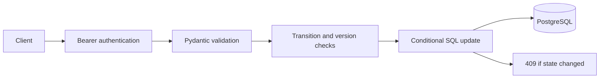

# Work Orders API

A focused Python/FastAPI backend demonstrating persistent work orders, authenticated access, explicit state transitions and protection against lost updates. PostgreSQL is the intended database; SQLite supports a quick local test loop.

**New portfolio demonstration using synthetic data. Not a client system or a claim of production deployment.**

## Why this example

A common business-system failure is accepting a change successfully, then displaying stale state or overwriting another user's update. This API reads persisted records and requires the caller's expected version before changing status. A database compare-and-swap ensures that two competing updates cannot both succeed.



## Quick start: Docker and PostgreSQL

Requires Docker Compose. Create a local `.env` with `DB_PASSWORD` (a generated alphanumeric password) and `API_TOKEN` (a generated ASCII token of at least 32 characters). Never commit that file. Generate values with `python -c "import secrets; print(secrets.token_hex(32))"`.

```sh
docker compose up -d db
docker compose run --build --rm api alembic upgrade head
docker compose up --build -d api
```

Open http://localhost:8000/docs and use **Authorize** with your token. Create an order with `{"title":"Inspect synthetic sensor data"}`, then PATCH its status using `{"status":"active","expected_version":1}`. Reload the order: its version is now 2. Repeating the stale update returns HTTP 409.

`docker compose down` stops services; the named database volume preserves records. Migration is a separate command so every web process does not try to modify the schema on startup.

## Local development and tests

Python 3.12+, isolated virtual environment:

```sh
python -m venv .venv
# Activate .venv using your shell's activation command
pip install -r requirements-dev.txt
pytest -q
ruff check .
ruff format --check .
```

For running without Docker, set `DATABASE_URL=sqlite:///./local.db` and a generated `API_TOKEN`, run `alembic upgrade head`, then `uvicorn app.main:create_app --factory`. Environment variable syntax depends on the shell; in PowerShell use `$env:NAME = 'value'`.

Tests apply the actual migration and cover authentication, validation, persistence, state transitions, stale writes, simultaneous updates and missing records. Set `TEST_DATABASE_URL` to an **empty disposable PostgreSQL database** to exercise the same tests there; the fixture downgrades its schema after each test. GitHub Actions tests both databases and builds the Docker image.

## API contract

| Endpoint | Purpose |
|---|---|
| `GET /health` | Process liveness, public |
| `POST /orders` | Create queued work order |
| `GET /orders?limit=20&offset=0` | Bounded paginated list |
| `GET /orders/{id}` | Read current persisted record |
| `PATCH /orders/{id}/status` | Change status with expected version |

Allowed transitions: queued → active/cancelled; active → completed/cancelled. Completed and cancelled records are terminal. Unknown fields and blank titles are rejected. OpenAPI is generated at `/openapi.json`.

## Trade-offs and production gaps

- A shared bearer token demonstrates authentication, **not user-specific authorisation or multi-tenancy**. Use an identity provider and per-resource access control for a multi-user deployment.
- Pagination orders by UUID for stable ordering of a static dataset; it does not provide a consistent snapshot while records are inserted.
- POST is not idempotent: callers must not blindly retry an uncertain create. An idempotency-key ledger is a deliberate future extension.
- No billing, background jobs, outbound messaging or external customer data.
- Production deployment needs HTTPS, managed secrets, backups, monitoring, readiness checks and request limits. `/health` is liveness only.
- SQLite tests are useful but not a substitute for PostgreSQL checks. Consult actual CI results for verified platforms.

Ryan Rose · [Engineering portfolio](https://underpin.cloud/engineering) · [Contact](mailto:ryan@underpin.cloud)
